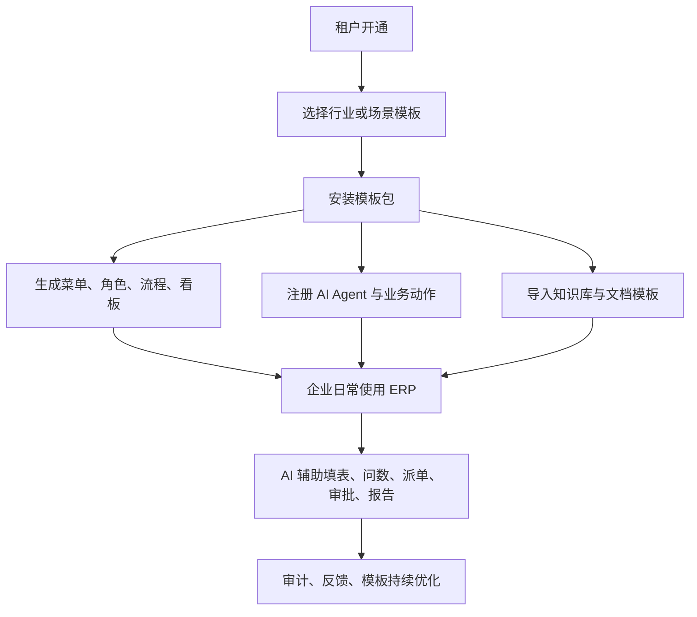
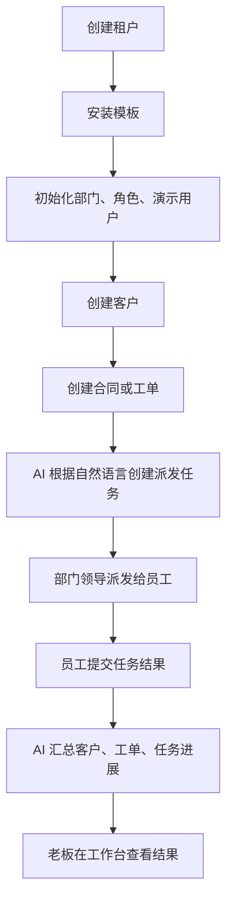

# 知语 AI 模板化 ERP 平台产品方案 V1.0

> 生成日期：2026-05-20  
> 项目路径：`d:\project\IdeaProjects\zwskchat`  
> 来源：基于当前项目文档、前后端代码结构、SQL 迁移脚本和已实现模块提取

---

## 1. 产品定位

### 1.1 一句话定位

**知语 AI 是面向中小企业的 AI 驱动模板化 ERP 平台。**

它不是单纯的知识库助手，也不是只面向某一个行业的固定 ERP，而是通过“多租户底座 + 行业模板 + ERP 业务模块 + AI Agent”组合，让企业可以快速开通自己的经营系统。

### 1.2 核心价值

> 用模板快速开通企业经营系统，用 AI 辅助录入、查询、总结、预警、派单、审批和执行业务动作。

核心价值包括：

- **快速开通**：企业通过模板中心选择行业/场景模板，快速生成菜单、角色、流程和业务能力。
- **减少录入**：AI 可以帮助创建客户、合同、工单、日程、派发任务等业务数据。
- **自然问数**：用户用自然语言查询客户、合同、工单、派发、日程、审批等业务数据。
- **业务执行**：AI 不只回答问题，还可以生成动作预览，经用户确认后执行业务操作。
- **知识沉淀**：企业制度、SOP、合同资料、工单经验、客户跟进记录可以沉淀到知识库。
- **过程监管**：多租户隔离、RBAC、动作审计、通知和权限边界保证业务可控。

---

## 2. 当前项目现状

### 2.1 已具备的基础底座

当前项目已经具备以下基础能力：

| 能力 | 当前状态 |
| --- | --- |
| 多租户 | 已支持 `tenant_id` 数据隔离，已有平台租户和多企业测试数据 |
| 认证授权 | Spring Security + JWT + Redis Token Store |
| RBAC | 用户、角色、权限、菜单权限基础已具备 |
| 部门组织 | 支持部门层级、负责人、路径、等级 |
| 知识库 | 支持知识库、文档、RAG 检索和异步索引 |
| AI 对话 | 支持文本对话、流式输出、引用来源 |
| 语音助手 | 支持 ASR、TTS、WebSocket 语音会话、语音诊断 |
| ERP 模块 | 已有客户、合同、工单、派发、日程、审批、通知等模块 |
| 模板中心 | 已有模板中心页面和模板安装接口雏形 |
| AI 动作中心 | 已有 AI 动作日志列表和业务动作服务雏形 |
| 平台管理 | 已有租户管理、平台看板、部门管理等能力 |

### 2.2 当前前端产品结构

当前前端导航已经按产品能力拆分为三组：

#### AI 功能

- 工作台
- 模板中心
- AI 对话
- AI 动作中心
- 知识库
- 语音助手
- 语音诊断

#### ERP 业务

- 客户管理
- 合同管理
- 工单管理
- 工作派发
- 日程管理
- 审批管理
- 通知中心
- 数据看板

#### 组织管理

- 部门管理
- 个人设置

这说明当前产品已经从“企业知识问答助手”升级为“AI + ERP 工作平台”的雏形。

### 2.3 当前已完成的重要增强

#### 多租户测试体系

当前测试数据已经覆盖三类企业：

- 销售型企业
- 软件研发企业
- 教育培训企业

每个企业包含：

- 约 30 个用户
- 8 个部门
- 6 条客户数据
- 1 个企业最高级领导 Boss
- 不同部门负责人和普通员工

#### 派发任务权限范围

当前派发任务已从“手填人员 ID”改为“部门下拉 + 人员下拉”：

- `SUPER_ADMIN` 可以指派给当前租户所有启用用户。
- 部门领导只能指派给自己负责部门内的启用用户。
- 普通员工不能越权指派，只能提交自己的任务结果。
- 后端会校验被指派人是否在当前用户可指派范围内。

---

## 3. 目标用户与典型场景

### 3.1 销售服务型公司

典型需求：

- 客户管理
- 跟进记录
- 合同管理
- 回款节点
- 售后工单
- 销售日报/周报
- 客户长时间未跟进提醒

适合模板：**通用经营模板**

### 3.2 项目交付型公司

适用于：

- 软件开发公司
- 工程实施公司
- 咨询服务公司
- 项目制服务公司

典型需求：

- 客户需求管理
- 合同/SOW 管理
- 项目任务拆分
- 工作派发
- 工单问题跟踪
- 交付验收
- 项目周报
- 延期风险预警

适合模板：**项目交付模板**

### 3.3 售后服务型公司

适用于：

- 客服团队
- 运维服务商
- 维修服务商
- 设备服务商
- 物业服务商

典型需求：

- 客户报修
- 工单分类
- SLA 管理
- 派单处理
- 客户确认
- 回访记录
- 知识库沉淀

适合模板：**售后服务模板**

### 3.4 教育培训公司

典型需求：

- 学员/客户管理
- 课程咨询
- 招生跟进
- 教务任务
- 排课日程
- 教学服务工单
- 教育经营数据统计

适合模板：**教育培训模板**

---

## 4. 产品总体架构

### 4.1 产品分层

### 4.2 四层架构

| 层级 | 说明 |
| --- | --- |
| 基础底座层 | 租户、用户、部门、角色权限、审计、通知、文件、知识库、AI Provider、向量库、流程引擎 |
| 业务能力层 | 客户、合同、工单、派发、日程、审批、通知、看板、导出 |
| 模板包层 | 行业模板、部门模板、流程模板、AI Agent 模板、报表模板、文档模板、知识库模板 |
| AI 编排层 | 意图识别、业务数据查询、动作预览、用户确认、执行、审计、反馈 |

---

## 5. 核心产品模块

## 5.1 平台运营后台

### 使用者

- 平台方
- 超级管理员

### 当前能力

- 租户管理
- 平台数据看板
- 部门管理
- 租户管理员独立管理页
- 租户 Boss 数量统计

### 应补强能力

- 套餐管理
- 模型消耗统计
- 存储用量统计
- 租户启停和到期管理
- 操作审计
- 系统健康监控
- 模板包管理

---

## 5.2 租户管理台

### 使用者

- 租户管理员 `TENANT_ADMIN`

### 当前能力

- 独立租户管理页
- 查看本企业用户
- 登录后根据角色分流

### 应补强能力

- 新增用户
- 编辑用户
- 停用用户
- 分配角色
- 分配部门
- 企业基础配置
- 已安装模板管理

---

## 5.3 AI 工作台

### 产品目标

用户登录后，不应该只看到聊天入口，而应该看到：

- 今天要做什么
- 有哪些待办
- 有哪些风险
- AI 发现了什么
- AI 可以帮我做什么

### 角色化工作台建议

| 角色 | 工作台重点 |
| --- | --- |
| 老板 | 收入趋势、合同风险、超期工单、部门负载、客户流失风险 |
| 销售 | 今日跟进、未跟进客户、即将到期合同、AI 跟进建议 |
| 客服/运维 | 待处理工单、超 SLA 工单、相似问题知识推荐 |
| 部门领导 | 本部门任务、本部门人员负载、待验收任务、可派发人员 |
| 普通员工 | 我的任务、我的工单、我的日程、需要提交的任务结果 |

---

## 5.4 AI 对话与 AI 动作中心

### AI 对话能力

AI 对话应支持：

- 问知识
- 问业务数据
- 创建业务数据
- 查询任务
- 生成总结
- 生成报告
- 发起派发
- 创建日程
- 创建提醒

典型指令：

- “帮我创建一个客户叫华为。”
- “本月有哪些合同要到期？”
- “把这个工单派给张三。”
- “明天下午两点提醒我跟进星河客户。”
- “生成本周销售简报。”

### AI 动作中心定位

> AI 做过什么、准备做什么、失败了什么，都集中在 AI 动作中心。

应支持：

- 待确认动作
- 已执行动作
- 执行失败动作
- 高风险动作
- 可撤销动作
- 用户反馈
- 动作审计

### AI 动作标准流程

---

## 5.5 模板中心

### 当前能力

模板中心当前已经可以展示：

- 模板名称
- 模板分类
- 模板描述
- 业务模块
- AI Agent
- 使用场景
- 安装状态
- 安装按钮

### 产品定位

> 模板不是几个页面，而是一组可安装的企业经营能力。

一个模板包应包含：

- 菜单
- 角色
- 权限
- 字段
- 表单
- 流程
- 看板
- AI Agent
- 知识库
- 文档模板
- 演示数据

### 首批模板建议

| 模板 | 适用场景 | 核心模块 |
| --- | --- | --- |
| 通用经营模板 | 销售、服务、贸易类企业 | 客户、合同、跟进、派发、审批、日程、报表 |
| 项目交付模板 | 软件、工程、咨询、实施服务 | 客户需求、合同、项目、任务、工单、验收、周报 |
| 售后服务模板 | 客服、维修、运维、设备服务 | 报修、分类、SLA、派单、处理、回访、知识库 |
| 教育培训模板 | 培训机构、教育公司 | 学员、课程、招生咨询、教务、排课、服务工单 |

### 下一步补强

- 模板安装后真正影响菜单和权限
- 模板安装后初始化角色
- 模板安装后初始化流程
- 模板安装后初始化 AI 动作
- 模板安装后初始化示例数据
- 支持模板版本升级和回滚

---

## 5.6 ERP 业务中心

### 客户管理

核心能力：

- 客户档案
- 联系人
- 跟进记录
- 客户状态
- 负责人

AI 增强：

- 自动总结跟进记录
- 提醒长期未跟进客户
- 生成客户报告
- 查询客户历史
- 推荐下一步动作

### 合同管理

核心能力：

- 合同列表
- 合同金额
- 合同状态
- 客户关联
- 文件字段
- AI 风险评分字段

AI 增强：

- 合同上传后自动抽取字段
- 自动识别风险条款
- 生成合同摘要
- 提醒合同到期
- 生成回款节点

商用缺口：

- 附件上传
- 附件版本
- 在线预览
- 合同审批
- 回款管理
- 续签和变更
- 操作时间线

### 工单管理

核心能力：

- 工单列表
- 优先级
- 状态
- 指派人
- 评论
- AI 分类和建议字段

AI 增强：

- 自动分类
- 推荐处理人
- 检索相似工单
- 生成处理建议
- 超时提醒
- 客户回访话术

### 工作派发

当前已具备：

- 最高级领导可选择所有部门和人员
- 部门领导只选择本部门人员
- 普通员工提交自己的任务结果
- 部门和人员下拉选择
- 后端强制校验可指派范围

后续建议：

- 支持一派多人
- 支持附件
- 支持截止时间
- 支持验收
- 支持退回重做
- 支持评论和进度时间线
- 支持 AI 从会议纪要拆任务

### 审批管理

核心能力：

- 流程定义
- 流程实例
- 我的待办
- 我发起的
- 审批通过/驳回

后续建议：

- 可视化流程配置
- 条件审批
- 部门负责人策略
- 角色审批策略
- 超时提醒
- 审批记录时间线

### 日程与通知

核心能力：

- 日程管理
- 任务提醒
- 通知中心

AI 增强：

- 自然语言创建日程
- 从客户跟进生成提醒
- 从派发任务生成提醒
- 从合同到期生成提醒
- 每日待办播报

---

## 5.7 知识库与语音助手

### 当前能力

- 知识库 CRUD
- 文档上传
- RabbitMQ 异步索引
- Qdrant 向量检索
- RAG 流式回答
- 语音助手
- ASR/TTS
- ASR 最终文本支持后端语义优化后回传前端展示
- 语音诊断
- 移动端适配

### 产品定位

> 知识库是企业经验底座，语音助手是自然交互入口。

典型场景：

- 售后人员问 SOP
- 销售问产品资料
- 新员工问公司制度
- 老板语音查询经营情况
- 客服语音生成工单处理记录

语音交互展示要求：

- 前端只负责展示实时 ASR 中间结果。
- 一轮语音结束后，最终展示文本以后端返回的语义优化结果为准。
- 操作者看到的最终文本必须与实际传给 AI 的请求语义保持一致。
- 原始 ASR 文本应保留给日志、审计和问题排查使用。

### 后续补强

- 文档 ACL 检索闭环
- 文档删除同步删除向量
- Reranker 精排
- 混合检索
- 知识命中反馈
- 权限过滤
- 语音 ASR 后端语义优化与前端回显闭环

---

## 6. 商用化缺口

当前系统已经能支撑演示，但距离真实企业商用还有以下关键缺口。

### 6.1 P0 缺口

| 缺口 | 说明 |
| --- | --- |
| 业务详情页不完整 | 多数模块还停留在列表/新增，缺少完整详情闭环 |
| 附件中心不统一 | 合同、工单、派发、审批都需要统一附件能力 |
| 业务时间线缺失 | 谁改了什么、谁审批了什么、AI 做了什么，需要统一记录 |
| AI 动作仍偏 Demo | 当前固定枚举和自由 JSON 不适合商用 |
| Text-to-SQL 安全层不足 | 需要语义视图、白名单、只读账号、行级权限、审计 |
| 语音展示与 AI 请求语义可能不一致 | 需要后端完成 ASR 语义优化，并把优化后的最终文本回传前端展示 |
| 编号规则不商用 | 工单、合同、派发等编号需要统一编号服务 |
| 数据权限需要细化 | 需要本人、本部门、本部门及下级、全租户、协作人等范围 |

### 6.2 P1 缺口

- 模板安装向导
- 模板版本升级
- 动态字段/表单
- AI 结果卡片
- 移动端业务操作体验
- 企业微信/钉钉通知
- Word/PDF 文档导出
- BI 问数和图表生成

---

## 7. MVP 产品边界

### 7.1 MVP 目标

**让一个新租户在 10 分钟内安装模板，并完成“客户到任务再到 AI 总结”的闭环。**

### 7.2 MVP 闭环

### 7.3 MVP 必做模块

- 模板中心真正安装生效
- 工作台角色化
- 客户详情页
- 合同详情页
- 工单详情页
- 工作派发详情页
- AI 动作审计
- 语音语义优化回显
- 通用附件中心
- 通用业务时间线
- 编号规则服务
- 权限数据范围

---

## 8. 推荐落地路线

### 第一阶段：商用闭环补齐

目标：让当前系统从“能演示”变成“能给一家企业试用”。

周期建议：2 到 4 周。

重点任务：

- 通用附件中心
- 通用业务时间线
- 编号规则服务
- 派发详情页
- 工单详情页
- 客户详情页
- 合同详情页
- AI 动作日志完善
- 工作台待办聚合

验收标准：

- 一个销售公司租户可以真实使用客户、合同、工单、派发、日程。
- AI 创建业务动作必须可预览、确认、审计。
- 语音输入完成后，操作者看到的是后端优化后的最终语义文本。
- 用户只能看到自己权限范围内的数据。

### 第二阶段：模板中心 MVP

目标：新企业开通时可以选择模板，自动生成菜单、角色、流程和 AI 能力。

周期建议：3 到 5 周。

重点任务：

- 模板包表
- 模板版本表
- 模板安装记录
- 模板角色映射
- 模板菜单
- 模板流程
- 模板 AI 动作
- 三个内置模板：通用经营、项目交付、售后服务

验收标准：

- 新租户能安装不同模板。
- 不同模板显示不同推荐模块。
- AI 动作中心能识别模板安装的动作能力。

### 第三阶段：AI Agent 产品化

目标：AI 从聊天助手升级为受控业务执行者。

周期建议：4 到 6 周。

重点任务：

- AI 动作定义
- 参数 schema
- 权限校验
- 风险等级
- 动作预览
- 用户确认
- 执行日志
- 失败重试
- 用户反馈
- 模型用量统计

验收标准：

- AI 可创建客户、合同、工单、日程、派发。
- 高风险动作必须确认。
- 每一次动作都可追踪。

### 第四阶段：轻量元数据对象

目标：支持模板定义简单业务对象，不必每次写 Java Entity 和固定页面。

周期建议：6 到 8 周。

重点任务：

- 业务对象定义
- 字段定义
- 列表视图
- 表单视图
- 状态流
- 动态 CRUD
- 动态权限
- AI 读取对象 schema 辅助填表

验收标准：

- 不写后端实体代码，也能创建一个简单业务对象。
- 模板可以带出自定义对象。
- AI 能识别该对象字段并辅助录入。

---

## 9. 产品路线图

| 阶段 | 产品目标 | 核心交付 |
| --- | --- | --- |
| 当前 | AI + ERP 雏形 | 多租户、RAG、语音、CRM、合同、工单、派发、审批、模板中心雏形 |
| P0 | 可试用闭环 | 附件、时间线、编号、详情页、AI 动作审计、工作台 |
| P1 | 模板化开通 | 模板安装、角色菜单流程初始化、三套模板 |
| P2 | AI Agent 化 | 动作注册、预览确认、审计、风险控制 |
| P3 | 平台化扩展 | 元数据对象、动态表单、模板市场、集成中心 |

---

## 10. 关键产品判断

### 10.1 不要只卖 AI 聊天

AI 聊天只是入口之一，真正价值在于：

- 表单里帮填
- 列表里帮筛
- 详情里帮总结
- 审批里帮判断
- 工单里帮推荐方案
- 工作台里帮发现风险

### 10.2 模板比行业更重要

早期不要把产品限制成“某某行业 ERP”。

更好的表达是：

- 通用经营模板
- 项目交付模板
- 售后服务模板
- 教育培训模板
- 行政办公模板

技术公司、教育公司、售后公司只是不同模板配置。

### 10.3 AI 写业务数据必须受控

企业软件里 AI 不能直接乱写数据库。

必须做到：

- 先预览
- 再确认
- 有权限
- 有审计
- 可追溯
- 可失败回滚或补偿

### 10.4 先补闭环，再做低代码

当前阶段不要直接追完整低代码 ERP。

推荐顺序：

1. 先补业务闭环
2. 再做模板安装
3. 再做 AI 动作注册
4. 最后做元数据对象和低代码能力

---

## 11. 下一步建议

建议下一步直接进入 **P0 商用闭环补齐**。

优先级如下：

1. 通用附件中心
2. 通用业务时间线
3. 编号规则服务
4. 派发详情页
5. 工单详情页
6. 合同详情页
7. 客户详情页
8. AI 动作审计表和动作中心增强
9. 角色化工作台
10. 模板安装真正生效

---

## 12. 最终结论

当前项目最适合继续做成：

# AI 驱动的模板化企业经营系统

核心产品逻辑是：

1. **底座统一**：多租户、用户、部门、权限、知识库、AI、流程、通知、附件、审计。
2. **模板开通**：不同行业或场景通过模板安装业务能力。
3. **ERP 承载业务**：客户、合同、工单、派发、审批、日程形成经营闭环。
4. **AI 嵌入流程**：AI 在业务中查询、生成、建议、派单、提醒和总结。
5. **动作可监管**：AI 写入业务数据必须预览、确认、审计、可追踪。

